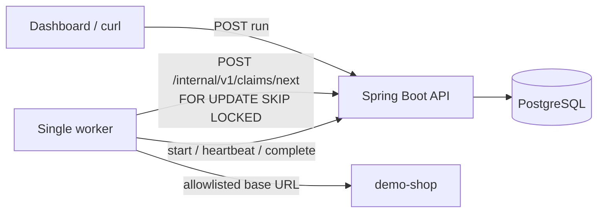
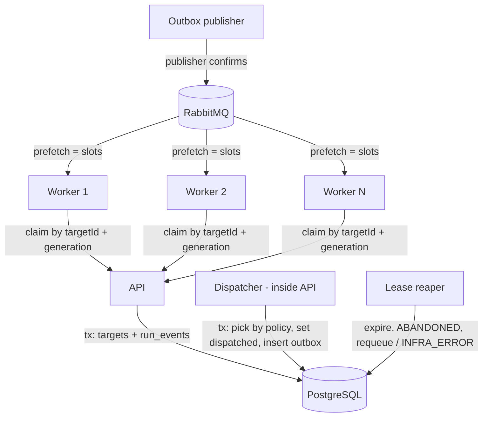
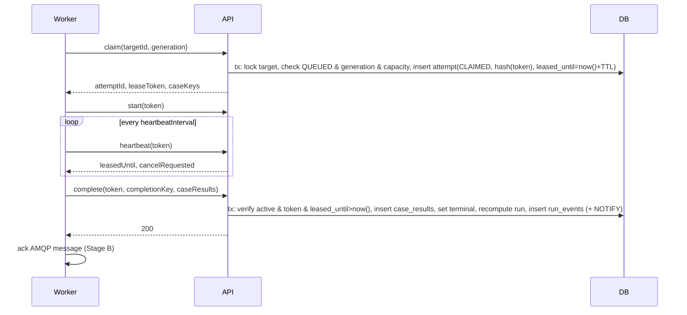

# System Architecture and Engineering Invariants — v2

The vocabulary used here (statuses, tables, events) is defined in `docs/API_AND_DATA_CONTRACTS.md`. Where this file and the contracts differ, the contracts win; fix this file in the same PR.

## 1. Components

| Component | Tech | Owns | Network |
|---|---|---|---|
| `web/` | React, TypeScript, Vite, Tailwind, TanStack Query, React Router | UI only. Holds no source-of-truth state | edge |
| `api/` | Java 21, Spring Boot, Spring Security, Flyway, springdoc-openapi | All state transitions, scheduling decisions, quality evaluation | edge (public port), internal (worker port) |
| `worker/` | Node, TypeScript, Playwright Test, pino, zod | Running allowlisted suites; reporting results | internal only |
| `demo-shop/` | Vite + React SPA with a small Express API | Deterministic fixture target | internal only |
| `cli/` | Node, TypeScript | CI submission, polling, quality gate exit codes | client |
| `chaos/` | Node, TypeScript | Fault drills and the invariant validator (local profile only) | internal |
| `packages/contracts` | Generated OpenAPI types, manifest JSON Schema, shared enums | Contract drift check in CI | — |
| PostgreSQL | pinned major version | Source of truth | internal |
| RabbitMQ (PRD-04+) | quorum queues | Transport only. Never the source of truth | internal |
| Observability (PRD-12, Compose profile `obs`) | OpenTelemetry Collector, Prometheus, Grafana, Jaeger | Traces, metrics, dashboards | internal plus a localhost UI |

## 2. Stages

### Stage A — first working path (PRDs 01–03)

- **Pull model:** the worker polls with `claims/next` (PRD-03 only; removed in PRD-04 T3, where the worker claims the target named in a dispatch message, CONFLICT_REGISTER N11).
- **Claim query:** `SELECT … FROM run_targets WHERE status='QUEUED' AND (not_before IS NULL OR not_before <= now()) ORDER BY queued_at, id LIMIT 1 FOR UPDATE SKIP LOCKED`, followed by the attempt insert in the same transaction.
- Even with a single worker, the lease protocol is real from day one. Statuses are never faked in the UI.

### Stage B — durable dispatch (PRD-04+)

### Stage C — observable, gated, optional cloud (PRDs 06–12)
- Artifact storage behind an interface: local volume by default, with an optional S3-compatible adapter.
- SSE streams from `run_events`. Postgres `LISTEN/NOTIFY` wakes the stream; the table remains the source of truth.
- The CLI and GitHub Actions read the quality evaluation from the server.
- The BrowserStack executor is a second worker executor. It reports through the same internal API.
- OpenTelemetry trace context flows: HTTP → outbox row → AMQP header → worker → Playwright child process environment.

## 3. Dispatch and scheduling ownership

To be ratified as **ADR-004** in PRD-00.

**Decision (proposed):** the database decides the order; the broker only delivers.

- **Run creation** inserts targets as `QUEUED`. Nothing is published yet.
- **The dispatcher**
  - Runs as a scheduled loop of about 250 ms, plus a nudge on `RUN_CREATED` and on every completion.
  - Under a `pg_advisory_xact_lock`, it computes `free = global_max_sessions − active_attempts − dispatched_unclaimed`.
  - It selects up to `free` eligible targets using the active policy:
    - `FIFO` in PRD-04
    - `LPT_AGING` in PRD-11
  - For each one it sets `dispatched_at`, increments `dispatch_generation`, and writes `outbox_events`, all in one transaction.
- **Why:** this keeps the broker queue short (at most the cap), so the scheduling policy actually controls execution order. It also makes the global cap enforceable in a single place.
- **Defence in depth:** the claim still re-checks capacity and the generation.
- **Trade-off:** the dispatcher becomes a central component.
  - It is single-instance in local mode; the advisory lock makes running several copies safe.
  - It adds up to one dispatch tick of latency.
  - The evidence must measure that latency, not assume it.

## 4. Lease protocol

**Worker crash**
1. Heartbeats stop.
2. The reaper runs every 5 s: `SELECT … WHERE status IN ('CLAIMED','RUNNING') AND leased_until < now() FOR UPDATE SKIP LOCKED`.
3. The attempt becomes `ABANDONED` (`LEASE_EXPIRED`) and is kept (`ATTEMPT_ABANDONED`).
4. If the run has a cancel request the target becomes `CANCELLED`. Otherwise, if retries remain (`attempt_count < max_attempts`), it returns to `QUEUED` with `dispatched_at = NULL` and `not_before = now() + backoff` (`TARGET_RETRY_SCHEDULED`); otherwise it becomes `INFRA_ERROR`.
5. The dispatcher re-dispatches it with a new generation, and the broker's redelivery of the old message is rejected as `stale-dispatch`.

**Lost dispatch** (PRD-04 T4, CONFLICT_REGISTER N17): the same pass also locks `QUEUED` targets whose `dispatched_at` is older than the dispatch timeout, i.e. whose message was dead-lettered or lost on the way back from the retry queue. They are undispatched so the dispatcher sends a new generation (`TARGET_RETRY_SCHEDULED`, reason `DISPATCH_TIMEOUT`), or end `INFRA_ERROR` (`WORKER_LOST`) once `max_attempts` dispatches in a row went unclaimed (`dispatch_generation − attempt_count`). The timeout must be longer than the longest legitimate queue wait; with more cap than worker slots a message can wait for a free slot, and a redispatch then is harmless (the old message gets `409`) but counts toward that limit.

**Late callback:** an old worker that wakes up (for example after `SIGSTOP`/`SIGCONT`) and calls `complete` gets `410 lease-expired`. It is logged with the attempt ID. Nothing is overwritten.

## 5. Invariants (checked by the PRD-10 validator; DB-enforced where possible)

| ID | Invariant | Enforcement |
|---|---|---|
| I1 | At most one active (`CLAIMED`/`RUNNING`) attempt per target | partial unique index |
| I2 | Terminal run, target and attempt statuses never change | conditional `UPDATE … WHERE status IN (non-terminal)` plus tests |
| I3 | `attempt_no` is 1..n per target with no gaps | `UNIQUE(target_id, attempt_no)` plus a validator query |
| I4 | A terminal target with status P/F/T has exactly one attempt with the same status; no case results exist on `ABANDONED` attempts | completion transaction plus validator |
| I5 | Active sessions never exceed `global_max_sessions` | dispatcher lock plus claim re-check; sampled by the validator |
| I6 | Run status equals the truth-table result of its target statuses | recomputed in every target-terminal transaction |
| I7 | Every committed `QUEUED` target is eventually dispatched (outbox row present until published) | outbox plus dispatcher |
| I8 | Every run reaches a terminal state within `max_attempts × (lease_ttl + max_backoff) + suite timeout`, or shows up in the `stuck_runs` operator query | reaper plus validator |
| I9 | A quality outcome of `PASS` never coexists with a missing or `INFRA_ERROR` required target | evaluator plus tests |

## 6. Default timings

These are starting values to tune with evidence, not claims.

| Setting | Default |
|---|---|
| Lease TTL | 30 s |
| Heartbeat interval | 10 s |
| Reaper interval | 5 s |
| Max attempts | 3 |
| Retry backoff | 2 s × 2ⁿ⁻¹ after the n-th attempt (2 s, 4 s, 8 s …), max 60 s, ±20 % jitter |
| Dispatch timeout (lost message) | 5 min |
| Dispatcher tick | 250 ms |
| Outbox poll | 500 ms, batch of 100 |
| SSE ping | 15 s |
| UI polling fallback | 5 s |
| Artifact retention | 7 days |
| Process kill grace | 10 s (`SIGTERM` → `SIGKILL` on the Playwright process group) |

## 7. Smart sharding (PRD-11)

- **What it does:** a run can ask for `sharding: {mode, shards: 1..4}`. The API then creates `shards` targets per engine and records which cases each one runs in `target_case_assignments`.
- **Modes**
  - `PLAYWRIGHT_NATIVE`: Playwright's own `--shard=i/n`, which splits by test file. This is the baseline.
  - `DURATION_BALANCED`: greedy LPT bin-packing. Sort cases by predicted duration (longest first), then give each one to the currently lightest shard using a min-heap. That's O(c log s).
- **How a shard runs its cases:** the worker builds `--grep` from the manifest tags of its assigned cases (allowlisted, escaped). The grep string never comes from a client.
- **Data rule:** every case is assigned to exactly one shard (test SHD-001).

## 8. Observability (PRD-03 → PRD-12)

- **PRD-03:** structured JSON logs (Logback JSON encoder in the API, pino in the worker), with `runId`, `targetId`, `attemptId`, `workerId` and `traceId` on every line.
- **PRD-04:** `traceparent` is stored on the outbox row and copied into the AMQP headers.
- **PRD-12 traces:** the OpenTelemetry Java agent instruments the API (Spring MVC, JDBC, RabbitMQ), and the OTel Node SDK instruments the worker. They export over OTLP to the Collector, which sends traces to Jaeger.
  - Expected trace: `POST /runs` → `dispatch` → `amqp publish` → `amqp consume` → `attempt.execute` → `playwright.case` spans.
- **PRD-12 metrics:** Micrometer → `/actuator/prometheus` → Prometheus → a provisioned Grafana dashboard (JSON committed). Metrics:
  - `testgrid_queue_wait_seconds` (histogram)
  - `testgrid_attempt_duration_seconds`
  - `testgrid_attempts_total{status}`
  - `testgrid_active_sessions`
  - `testgrid_outbox_unpublished`
  - `testgrid_reaper_reclaimed_total`
  - `testgrid_dlq_depth`
  - `testgrid_sse_clients`
- **Alert rules (example only, no paging):** outbox lag over 30 s, DLQ depth above 0, active sessions above the cap.

## 9. Deployment topology (local)

- **Two Compose networks**
  - `edge`: web and API public port
  - `internal: true`: db, mq, workers, demo-shop, API worker port, observability
- Only `web` and the API public port are bound, to `127.0.0.1`.
- The worker reaches only the demo-shop (and BrowserStack hosts when that executor is enabled).
- Profiles:
  - `default`: db, api, web, demo-shop, worker, and rabbitmq from PRD-04 (CONFLICT_REGISTER N14: dispatch needs the broker, so a separate `queue` profile would leave targets queued forever)
  - `obs`: collector, prometheus, grafana, jaeger
  - `s3`: S3-compatible store (optional)
  - `chaos`: chaos runner

## 10. Security boundary

- Workers execute only checked-in suites against the allowlisted demo origin, inside a non-root container with resource limits.
- No public `targetUrl`, code string, Docker socket mount or untrusted repository runner exists in core scope.
- Arbitrary user code would need a new sandbox design and threat model first.

## 11. Measurement fields

**Recorded:** `queued_at`, `dispatched_at`, `claimed_at`, `started_at`, `finished_at`, `worker_id`, `attempt_no`, `engine`, `shard_index`, `error_class`, `commit_sha`, `suite_revision`.

**Derived:**
- queue wait = `claimed_at − queued_at`
- dispatch latency = `dispatched_at − queued_at`
- execution time = `finished_at − started_at`
- makespan = last finish − first queued
- utilization = busy seconds ÷ (workers × wall-clock time)

No number appears in any document before a benchmark has produced it.

## 12. When to write an ADR

Add an ADR to `docs/decisions/` whenever any of these change: queue technology, data model, API version, lease behaviour, dispatch or scheduling ownership, artifact store, auth model, observability backend or cloud integration.
